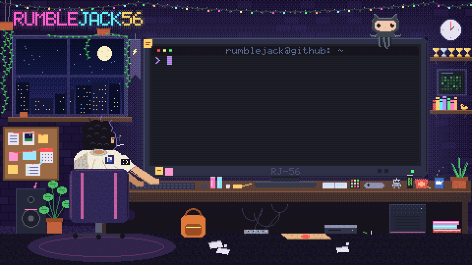
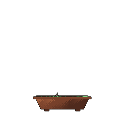

## Where I've worked

  
  &nbsp;&nbsp;&nbsp;&nbsp;
  
  &nbsp;&nbsp;&nbsp;&nbsp;
  

## Toolbox

  
  
  
  
  
  
  
  
  
  
  
  
  
  
  
  
  
  
  
  
  
  
  
  
  
  
  
  
  
  
  
  
  
  
  
  
  
  
  
  
  
  
  
  
  <picture><source media="(prefers-color-scheme: dark)" srcset="imgs/logos/aws-dark.svg"></picture>
  
  
  
  <picture><source media="(prefers-color-scheme: dark)" srcset="https://cdn.simpleicons.org/vercel/white"></picture>
  
  
  
  
  
  
  
  
  
  
  
  
  
  
  
  
  
  
  
  
  
  <picture><source media="(prefers-color-scheme: dark)" srcset="https://cdn.simpleicons.org/github/white"></picture>

 

<picture>
  <source media="(prefers-color-scheme: dark)" srcset="https://raw.githubusercontent.com/RumbleJack56/RumbleJack56/output/github-snake-dark.svg">
  <source media="(prefers-color-scheme: light)" srcset="https://raw.githubusercontent.com/RumbleJack56/RumbleJack56/output/github-snake.svg">
  
</picture>

