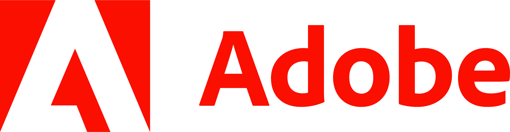
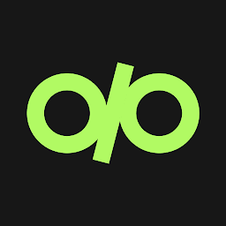

<div align="center">


<h1>
  <a href="https://git.io/typing-svg">
    
  </a>
</h1>


</div>

```text
$ whoami
rumblejack — CS undergrad @ Delhi Technological University (2027)
             AI/ML engineer by day, terminal dweller by night

$ cat ~/.focus
- build small tools that fix my own annoyances
- terminal UIs over web UIs
- agentic AI, memory systems, and the plumbing around LLMs
```

## What lives here

| | |
|---|---|
| 🛠️ **Scripts** | Shell and Python glue for my Linux workflow: automation, dotfile helpers, one-off fixes that became permanent. |
| 🖥️ **TUIs** | Terminal interfaces for the things I check too often. |
| 🧪 **Projects** | Larger builds, from ML research to full-stack systems. |
| 🧰 **Skills** | Reusable skills and agent tooling I use day to day. |

<!-- TODO: replace with real repos. Pinned repos on the profile can carry this too.
- [`repo-name`](https://github.com/RumbleJack56/repo-name) — one line on what it does
-->

## Selected work

- **EVOLVE-MEM** — self-adaptive hierarchical memory for agentic AI systems. F1 0.583 vs 0.327 for the strongest baseline. *SEA workshop, NeurIPS '25.*
- **Decibel** — audio-language model: Mixture-of-Experts over 7 distilled experts, Falcon-7B + LoRA, runs in under 8 GB VRAM. [Code](https://github.com/RumbleJack56)
- **EmoGTN** — multimodal gated transformer for emotion recognition, 72.7% weighted F1 on IEMOCAP. [Code](https://github.com/RumbleJack56)
- **Adwise** — real-time bidding pipeline under a 2 ms / 512 KB budget, 0.96 AUC-ROC.

## Where I've worked

<table>
  <tr>
    <td width="140" align="center"></td>
    <td>Product (SDE) Intern, 2026. A visual podcast engine for PDFs, plus an animated-infographics renderer built on Manim.</td>
  </tr>
  <!-- TODO: add logo files to imgs/ and uncomment.
  <tr>
    <td width="140" align="center"></td>
    <td>AI Intern, 2025–26. A GraphRAG backend for ESG compliance serving 20+ B2B clients.</td>
  </tr>
  <tr>
    <td width="140" align="center"></td>
    <td>AI Engineering Intern, 2025. Question generation and AI-teacher feedback for 10k+ daily users.</td>
  </tr>
  -->
</table>

Also: Head of AI at AIMS-DTU, Secretary (Quantum Computing) at ACM-DTU. Winner at Techfest IIT Bombay (twice), BuildWithDelhi '24, and Smart India Hackathon 2025 grand finalist.

## Toolbox

<p>
  
  
  
  
  
  
  
  
  
  
  
  
  
  
  
  
  
  
  
  
  
  
  
  
  
  
  
  
  
  
  
  
  
  
  
</p>

<div align="center">
<picture>
  <source media="(prefers-color-scheme: dark)" srcset="https://raw.githubusercontent.com/RumbleJack56/RumbleJack56/output/github-snake-dark.svg">
  <source media="(prefers-color-scheme: light)" srcset="https://raw.githubusercontent.com/RumbleJack56/RumbleJack56/output/github-snake.svg">
  
</picture>
</div>
