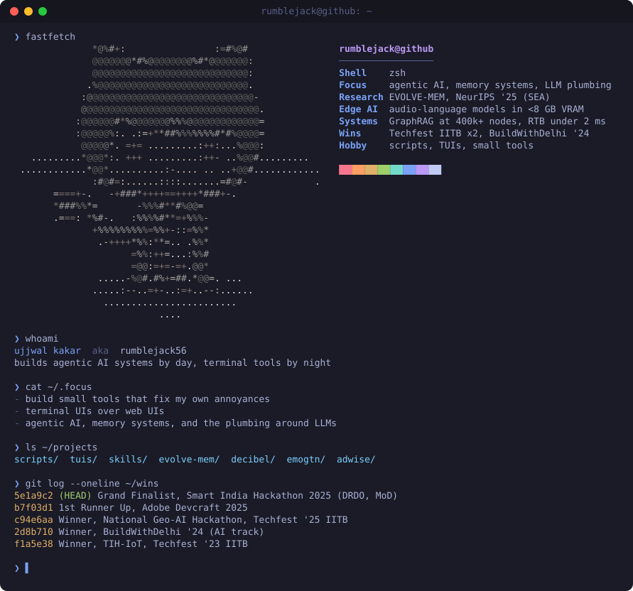

# Terminal card variants

Generated by [`scripts/gen_terminal.py`](../scripts/gen_terminal.py). Pick one and point the main README at it.

### v1 — Tokyo Night, macOS window (static)

### v2 — Dracula, macOS window, typing animation

### v3 — Hacker green, borderless retro

Plain-text ASCII Codercat (usable as a fastfetch logo): [`imgs/terminal/codercat.txt`](../imgs/terminal/codercat.txt)
